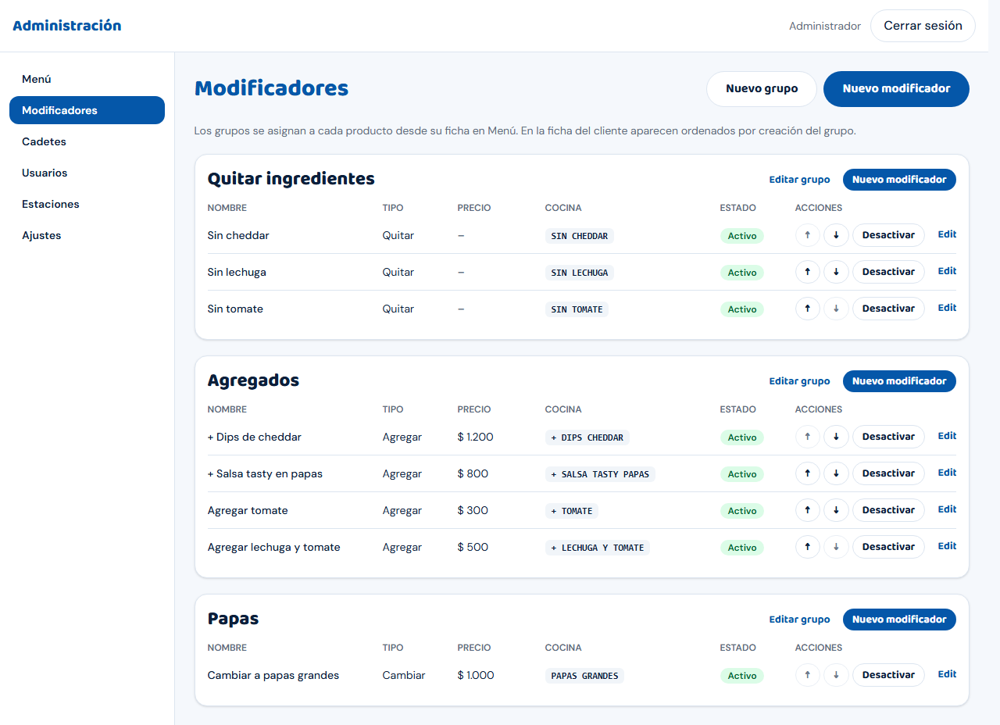
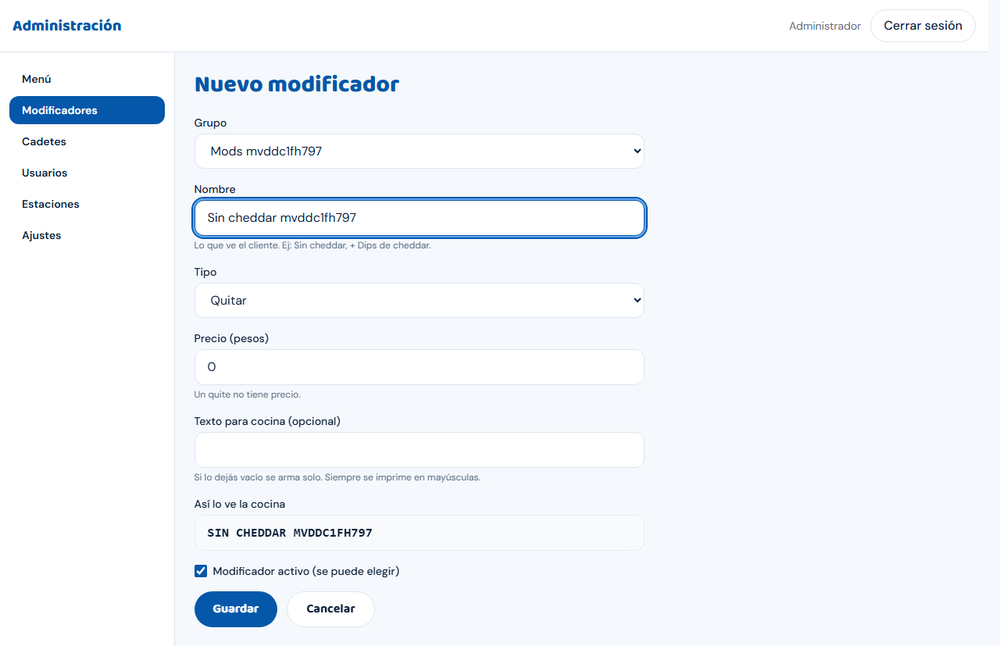
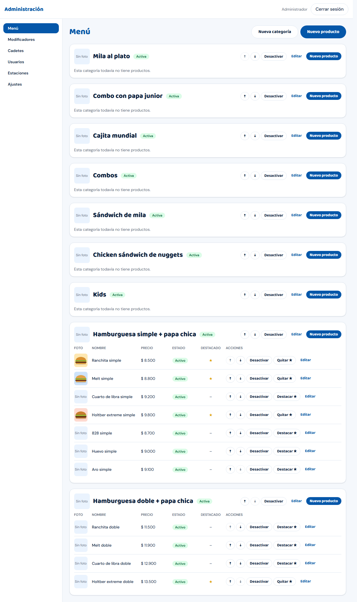
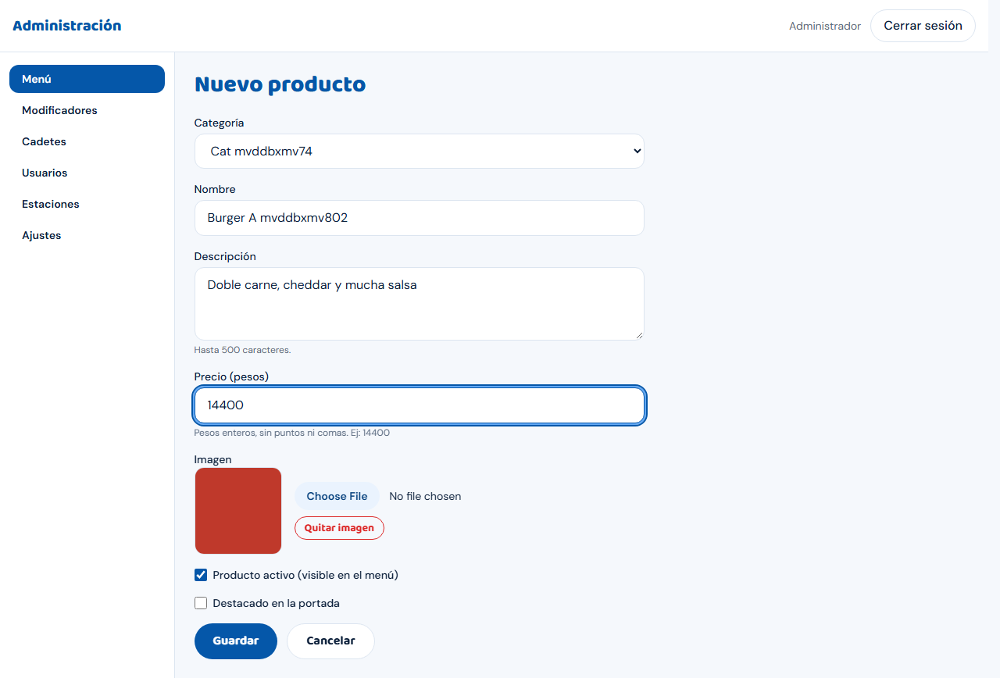

# Guía de carga del menú real (Administrador)

Se hace **una sola vez**, antes de abrir al público, entrando como administrador a `https://<dominio>/admin`. No hay carga masiva
(importación): se carga todo desde las pantallas de **Administración**, de a uno. Con una carta de unos 100 productos calculá una tarde completa.

> **Nunca uses `pnpm db:seed` en producción**: carga productos de demostración y se niega a correr en una base de producción. El menú real se carga a mano
> por estas pantallas.

## Preparar el material antes de empezar

1. La **carta actual** (de pxw o impresa) con nombres exactos, categorías en el orden en que se muestran y **precios vigentes**.
2. Una **foto por producto** (formato JPG, PNG o WebP; **máximo 5 MB** cada una; mejor cuadradas y bien iluminadas; el sistema las convierte y achica
   solo). Guardalas con el nombre del producto para encontrarlas rápido.
3. La lista de **qué se puede quitar o agregar** en cada producto (ver "Modificadores").
4. Ajustes del local (si todavía no se cargaron): `guia-administrador.md`, sección Ajustes.

## Orden recomendado

**Modificadores primero, después categorías, después productos.** Así al crear cada producto ya podés asociar sus modificadores.

### 1. Modificadores (Administración → **Modificadores**)

Un **grupo** junta modificadores parecidos (por ejemplo "Quitar ingredientes", "Extras", "Cambiar papas"). Cada **modificador** es una opción que el cliente
puede tildar en cada unidad del producto.

1. **Nuevo grupo** → **Nombre** → **Guardar**.
2. **Nuevo modificador** (o el botón dentro del grupo):

   

   - **Grupo**: al que pertenece.
   - **Nombre**: lo que ve el cliente (por ejemplo "Sin cheddar", "+ Dips de cheddar", "Papas grandes").
   - **Tipo**: **Quitar** (sin precio), **Agregar** (suma plata) o **Cambiar** (puede sumar plata).
   - **Precio (pesos)**: entero, sin puntos ni comas (por ejemplo `1200`). Un "Quitar" no tiene precio.
   - **Texto para cocina (opcional)**: si lo dejás vacío se arma solo (por ejemplo "SIN CHEDDAR"); siempre sale en mayúsculas. Hoy se ve en las pantallas
     del personal (en delivery y mostrador, chips rojos/verdes bajo cada producto); no hay comanda impresa.
3. Podés **Subir/Bajar** para ordenar y **Desactivar/Activar** un modificador.

### 2. Categorías (Administración → **Menú**)

1. **Nueva categoría** → **Nombre** (el **Slug** es opcional y se arma solo) → **Guardar**.
2. Ordenalas con **Subir / Bajar** en el mismo orden de tu carta. **Desactivar** una categoría la oculta de la tienda.

### 3. Productos (Administración → **Menú**)

En cada categoría: **Nuevo producto** (o el botón general **Nuevo producto**).

| Campo | Qué poner |
| --- | --- |
| **Categoría** | La del producto |
| **Nombre** | El que ve el cliente. Las variantes ("Ranchita simple", "Ranchita doble") son **productos separados** |
| **Descripción** | Hasta 500 caracteres (ingredientes, qué incluye) |
| **Precio (pesos)** | Entero, sin puntos ni comas (por ejemplo `14400`) |
| **Imagen** | Elegir archivo (JPG/PNG/WebP, hasta 5 MB); aparece una vista previa; **Quitar imagen** si te equivocás |
| **Producto activo (visible en el menú)** | Tildado para que se vea |
| **Destacado en la portada** | Para el carrusel de destacados de la tienda |

Apretá **Guardar**. Después, abriendo el producto (**Editar**), abajo está **Grupos de modificadores**: tildá los grupos que se ofrecen en ese producto y
apretá **Actualizar grupos**.

Para ordenar productos dentro de la categoría: **Subir / Bajar**. Para destacarlos: **Destacar ★**. Para sacar uno de la venta sin borrarlo: **Desactivar**.

## Revisión final (obligatoria)

1. Abrí la tienda **en un celular** (`https://<dominio>/`): categorías en el orden correcto, fotos que cargan, precios iguales a la carta, ningún producto de demo.
2. Abrí 3 productos con modificadores y armá un pedido: mirá que el **total** sea el esperado (productos + modificadores + envío).
3. Hacer el **pedido de prueba completo** del checklist (aprobar, imprimir, cobrar) y cancelarlo después (UAT C5-C8 y E1).
4. Cambios posteriores (precio, agotado, foto nueva) se hacen igual desde estas pantallas y se ven al instante en la tienda; los pedidos ya hechos **no cambian**
   (guardan el nombre y el precio de cuando se compró).

## Errores frecuentes

| Qué pasa | Qué hacer |
| --- | --- |
| "Ya existe…" al guardar | Hay otro con el mismo nombre en esa categoría o grupo: cambiá el nombre. |
| El precio da error | Solo números enteros, sin `$`, puntos ni comas. |
| La imagen no sube | Pesa más de 5 MB, o no es imagen: reducila. Si es chica y falla, avisar a soporte (runbook sección 9). |
| Cargué algo mal en un pedido real | No se borra; se corrige hacia adelante. Para el menú: editar o **Desactivar**. |
| Ves productos de ejemplo ("Ranchita simple" de demo) que no cargaste | Alguien corrió el seed de demo. **No sigas**; avisá a soporte antes de borrar nada. |
