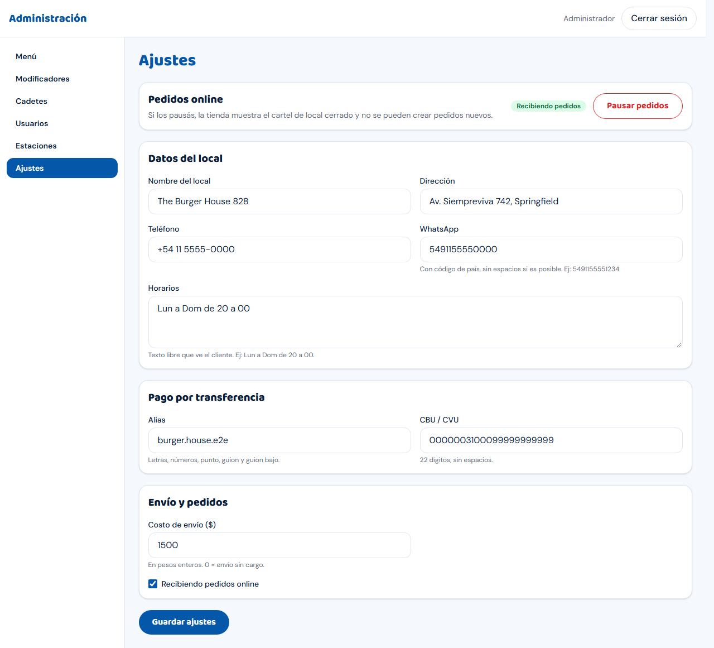
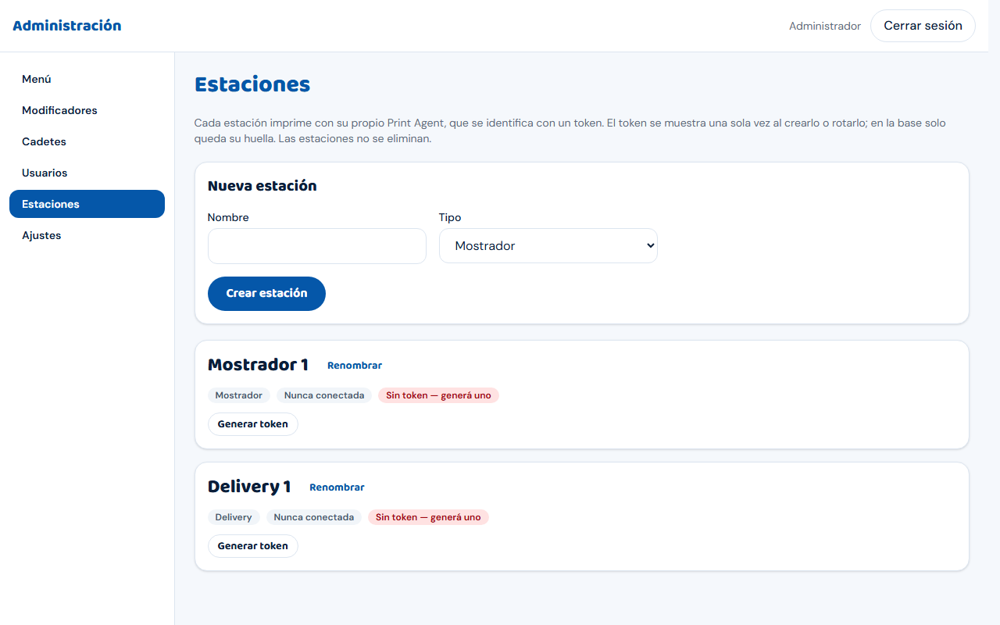
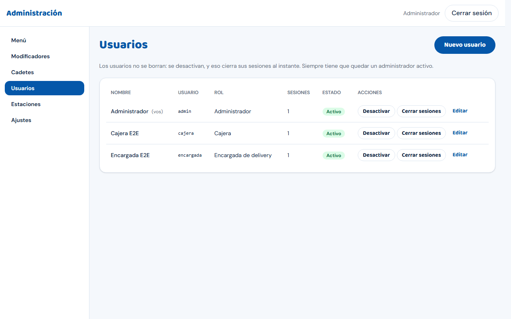

# Guía de una página: Administrador

El administrador entra con su usuario y cae en **Administración**. En el menú lateral de las pantallas de staff también ve **todas**
las pantallas de trabajo: **Venta**, **Mostrador**, **Retiro en local**, **Gestión Delivery**, **Rendición**, y dos vistas
generales: **Vista general** (`/caja`) y **Tablero general** (`/despacho`). El administrador **no** está limitado por sector.

## Menú de Administración

**Menú · Modificadores · Cadetes · Usuarios · Estaciones · Ajustes**.

### Ajustes (`/admin/ajustes`)

- **Pedidos online**: **Pausar pedidos** / **Reanudar pedidos**. Pausado, la tienda muestra el cartel "Por el momento no estamos tomando
  pedidos" con los **Horarios**, y no se pueden crear pedidos web nuevos. Úsalo para cerrar el local o frenar una avalancha.
  (La casilla **Recibiendo pedidos online** abajo hace lo mismo; recordá **Guardar ajustes** si la cambiás ahí.)
- **Datos del local**: nombre, dirección, teléfono, WhatsApp (con código de país, ej. 5491155551234), **Horarios** (texto libre).
- **Pago por transferencia**: **Alias** y **CBU / CVU** (22 dígitos). Es lo que ve el cliente al elegir transferencia.
- **Envío y pedidos**: **Costo de envío ($)**, en pesos enteros (0 = sin cargo). **Cierre del día de trabajo**: la hora (Buenos Aires, por defecto **06:00**) en la que
  el número de pedido vuelve a 1. Una venta de las 23:50 y otra de las 00:05 son del mismo día de trabajo; el número reinicia recién a la hora de cierre.
  Cambiarlo no renumera pedidos ya hechos.

- Terminá con **Guardar ajustes**.

### Estaciones (`/admin/estaciones`)

- Una estación por PC: **Mostrador 1 a 4** y **Delivery 1 a 5**. **Nueva estación**: **Nombre**, **Tipo** (Mostrador / Delivery), **Crear estación**.
  El tipo decide qué pedidos ve y dónde se imprime: no lo cambies a la ligera. Las estaciones no se eliminan; se pueden **Renombrar**.
- **Generar token** (o **Rotar token**): el token se muestra **una sola vez** ("Guardalo ahora"). Copialo y cargalo en el instalador de la PC
  (`docs/ops/print-agent-install.md`). Rotar corta al instante el agente anterior. **No lo mandes por chat.**
- Cada estación muestra si el agente está conectado o **Nunca conectada**.

### Usuarios (`/admin/usuarios`)

Una cuenta por persona: **Nombre**, **Usuario** (3 a 40 caracteres, minúsculas), **Rol** (cajera / encargada de delivery / **cocina** / administrador) y
**Contraseña** (mínimo 8). Desde la lista: **Desactivar** una cuenta (quien se va), **Cerrar sesiones de <usuario>**; al editar, **Nueva contraseña**
(cierra sus sesiones). Siempre tiene que quedar al menos un administrador activo. La cajera solo puede elegir estaciones de Mostrador y la
encargada solo de Delivery. El rol **Cocina** es el login del **televisor del mostrador**: no usa estación, entra directo a `/pantalla` (los números de pedido en preparación y listos), con sesión de 400 días, y no ve cobros ni ninguna otra pantalla (si abre otra URL, vuelve al televisor). Cómo dejarlo en modo kiosco: [Guía de cocina y del televisor](guia-cocina.md).

### Cadetes (`/admin/cadetes`)

**Nuevo cadete**: **Nombre**, **Teléfono** (opcional), **Cadete activo (se puede asignar a pedidos)**. No tienen acceso al sistema: la encargada registra por ellos.

### Menú y Modificadores

Ver `docs/guias/carga-del-menu.md` (paso a paso, con capturas).

## Avisar una demora

Si la cocina se atrasa o pasa algo (se pinchó el delivery, falta un ingrediente), podés avisar una demora desde el botón **Demora** de la
barra de arriba (dice **Sin demora** o **+10 min**). Hay dos clases:

- **Automática**: el sistema calcula solo la espera según los pedidos en preparación. No hacés nada; la ves en el panel como "Estimación automática".
- **Manual**: la activás vos y se **suma** a la automática. Los clientes ven una espera más larga.

**Activar**: tocá **Demora**, elegí los minutos extra (**+5** a **+60**), escribí el **motivo** y apretá **Activar demora**. Si ya había una,
la nueva la reemplaza.
**Desactivar**: tocá **Demora** y **Desactivar demora**. Queda registrado quién la activó y quién la sacó.

El **motivo es interno**: lo ve solo el personal, nunca el cliente.

## Controles del día a día

- **Abrir / cerrar el local para pedidos web**: Ajustes → **Pausar pedidos** / **Reanudar pedidos**.
- **Producto agotado**: Menú → **Desactivar** en la fila del producto (deja de verse en la tienda; **Activar** lo vuelve).
- **Impresión**: en **Estaciones** ves si cada agente está conectado; si una PC no imprime, `docs/ops/runbook.md` sección 5.3.
- **Supervisar**: **Vista general** y **Tablero general** muestran todos los sectores a la vez.

## Cosas que NO se hacen desde el sistema (pedir al soporte técnico)

Deploy y rollback, backups y restauración, cerrar todas las sesiones, etiquetar y desplegar una versión, certificados: `docs/ops/runbook.md`.
