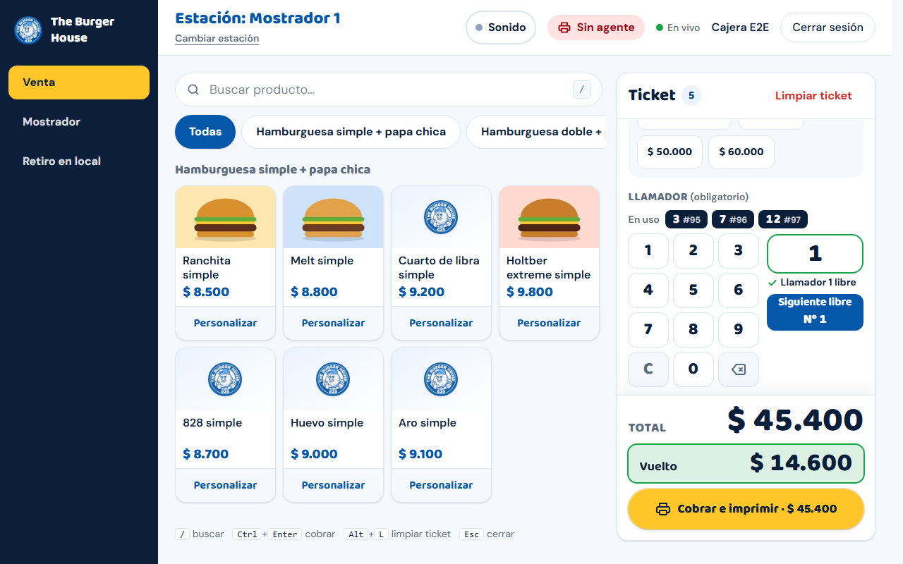
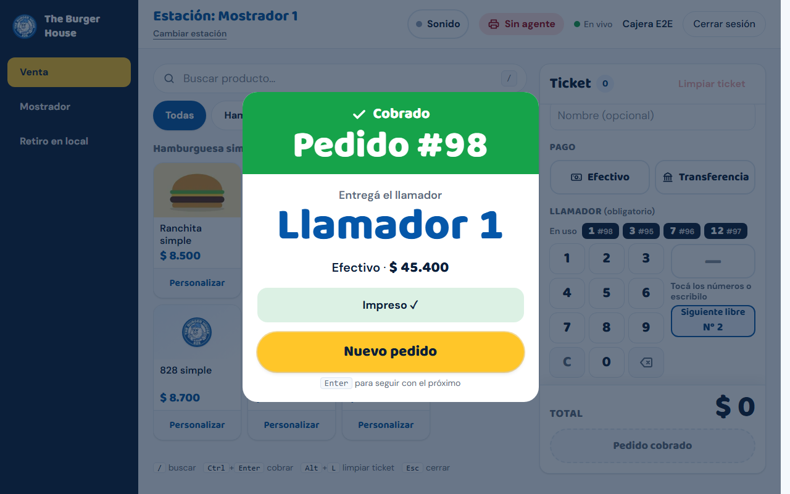
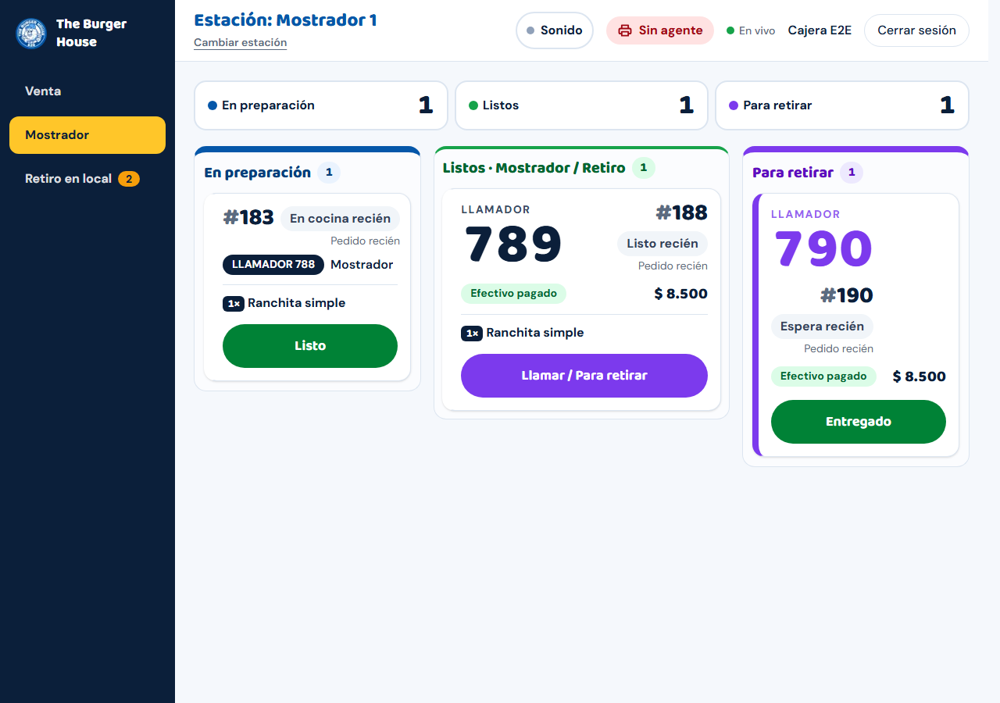
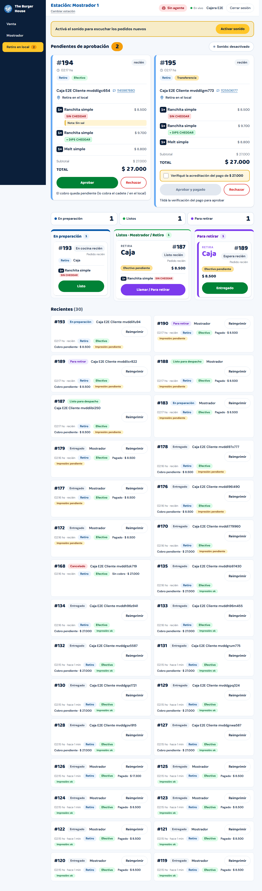

# Guía de una página: Cajera / Mostrador

Para quien trabaja en una PC de **Mostrador** (Mostrador 1 a 4). Las capturas usan datos de prueba.

## Empezar el turno

1. Abrí la dirección del sistema en el navegador y entrá con **tu usuario y contraseña** (botón **Ingresar**).
2. En **"¿Dónde estás trabajando?"** tocá **tu estación** (por ejemplo "Mostrador 1"). Es la PC y la impresora de la que sale
   el papel. Si te equivocás de estación, usá **Cambiar estación** (arriba, debajo del nombre de la estación).
3. Arriba a la derecha mirá tres señales:
   - **"Impresora lista"** (verde): el programa de impresión de esta PC está conectado. **"Sin agente"** (rojo): no
     va a salir papel hasta que vuelva (ver "Si algo falla").
   - **"En vivo"**: la pantalla se actualiza sola. **"Reconectando…"** o **"Sin conexión"**: se cortó internet.
   - **Sonido**: tocá **Activar sonido** una vez por turno para que suene cuando entra un pedido web nuevo (el navegador lo exige).
4. A la izquierda tenés **tres pantallas**: **Venta**, **Mostrador** y **Retiro en local**.

## 1. Venta en el mostrador (pantalla **Venta**)

1. Tocá un producto para sumarlo al **Ticket** (una unidad lista, sin cambios). Para quitar ingredientes o agregar
   extras tocá **Personalizar**, elegí y apretá **Agregar al ticket**. Buscá por nombre en **Buscar producto…** (atajo: tecla `/`).
2. En el ticket elegí el **método de pago**: **Efectivo** o **Transferencia**. Con efectivo podés tocar el monto que te dan
   (**Justo $…** o un billete) y la pantalla muestra el **Vuelto**.
3. **Llamador (obligatorio)**: tocá el número en el teclado o usá **Siguiente libre**. Los llamadores ocupados aparecen
   en **En uso** (con el número de pedido); no se puede repetir uno en uso.
4. Si querés, poné el nombre del cliente (**Nombre (opcional)**).
5. Apretá **Cobrar e imprimir · $total** (atajo `Ctrl+Enter`). El botón te dice qué falta: "Agregá productos al ticket",
   "Elegí el método de pago", "Ingresá el llamador".
6. Aparece la confirmación con **Pedido #N** y **Llamador n**:

   

   Tiene que decir **Impreso ✓** (salen **dos** papeles: primero el **ticket de cocina**, que llevás a la cocina, y después el **ticket del cliente**, con logo y "GRACIAS POR TU COMPRA"). Si dice
   **Esperando la impresora…** esperá unos segundos; si dice **Falló la impresión**, revisá papel/cable y apretá **Reimprimir**.
   Para la próxima venta apretá **Nuevo pedido** (o Enter).

> El **ticket de cocina** sale impreso en tu impresora, antes del ticket del cliente (número, MOSTRADOR/RETIRO, llamador, cada producto por unidad con sus cambios, la nota y la hora). **Vos marcás el pedido**: cuando la cocina avisa que está armado, apretá **Listo** en **Mostrador** o en **Retiro en local** (suena el aviso y el número pasa a "¡Listo!" en el **televisor del mostrador**, mirá la [Guía de cocina y del televisor](guia-cocina.md)), y **Entregado** cuando el cliente lo retira (el número sale del televisor). En el menú, **Pantalla** abre ese televisor en una pestaña nueva.

Otros atajos: `Alt+L` limpiar el ticket, `Esc` cerrar.

## 2. Seguir las ventas (pantalla **Mostrador**)

Tres columnas con las ventas de mostrador:

| Columna | Qué hacés |
| --- | --- |
| **En preparación** | Cuando esté lista la comida, tocá **Listo**. |
| **Listos · Mostrador / Retiro** | Llamá al cliente por el llamador y tocá **Llamar / Para retirar**. |
| **Para retirar** | Cuando el cliente retira, tocá **Entregado**. |

## 3. Pedidos web de retiro (pantalla **Retiro en local**)

Acá llegan **solo** los pedidos web "Retiro en el local" (los de delivery van a la PC de Delivery). Al entrar uno suena el
aviso (si activaste el sonido) y aparece un número rojo en el menú.

**Aprobar**

- **Efectivo**: apretá **Aprobar** ("el cobro queda pendiente": se cobra al entregar).
- **Transferencia**: **primero verificá en tu banco que la plata llegó**, tildá **"Verifiqué la acreditación del pago de $…"** y
  recién ahí se habilita **Aprobar y pagado**. Sin la tilde el botón no funciona.
- Al aprobar, **esta estación imprime el ticket de cocina y el ticket del cliente** (en ese orden) y el pedido pasa a **En preparación**.

**Rechazar**: **Rechazar** → elegí un motivo (**Sin stock**, **Zona sin cobertura**, **Pago no acreditado**, **Datos incompletos**) o
escribí uno (mínimo 3 letras) → **Rechazar pedido**. El cliente ve su pedido como cancelado, con ese motivo.

**Cancelar un pedido ya aprobado** (se equivocó la carga, el cliente se arrepintió, no hay stock): en la tarjeta del pedido (**En preparación**, **Listos** o **Para retirar**) tocá
**Cancelar pedido**, elegí un motivo (**Cliente canceló**, **Error de carga**, **Sin stock**, **No se pudo entregar**) o escribí uno (obligatorio, mínimo 3 letras) y confirmá con
**Cancelar pedido**. El pedido sale del tablero, **el llamador queda libre** y no se imprime nada más de ese pedido. La cancelación **no devuelve plata**: si ya se cobró,
el reintegro lo resolvés aparte con el cliente. Una venta ya **Entregada** no se puede cancelar. Sirve igual para anular una venta del mostrador cargada por error.

**Después**: **Listo** → **Llamar / Para retirar** → **Entregado** (igual que en Mostrador). Si el pedido era en **efectivo**, al
tocar **Entregado** aparece **"Cobrá $… antes de entregar"**: recibí la plata, tildá **Cobré $…** y apretá **Entregar pedido**.

**Recientes** (abajo): últimos pedidos con su estado y la marca de impresión (**Impresión: ok / pendiente / falló**) y el botón **Reimprimir**.

## Modificar un pedido

Si el cliente te escribe por WhatsApp para cambiar algo, **no cargues un pedido nuevo**: modificá el mismo. Así hay un solo número, un solo envío y la cocina ve todo. Lo que se puede hacer depende de en qué punto está el pedido.

**Antes de aprobarlo** (pedidos web de **Retiro en local**, pestaña **Por aprobar**): tocá **Editar pedido** en la tarjeta.

1. Para sacar algo, tocá **Quitar** al lado de esa unidad (si te arrepentís, **Deshacer**). Para sumar algo, elegilo abajo, en **Agregar**.
2. Mirá el **Total nuevo** que aparece antes de guardar. El costo de envío no cambia.
3. Tocá **Guardar cambios**. El pedido tiene que quedar con al menos un producto: si no se va a hacer nada, usá **Rechazar**.

**Con el pedido ya aprobado (En preparación)**: ya no se puede sacar ni cambiar lo que estaba, **solo agregar**. En la tarjeta tocá **Agregar productos** (en **Retiro en local**, pestaña **En preparación**, o en **Mostrador** para las ventas de mostrador).

1. Elegí lo que se suma y tocá **Agregar al pedido**. Antes de guardar, el cuadro te dice cómo se cobra:
   - **Venta de mostrador**: **"Cobrá $… ahora"**. Cobrale la diferencia al cliente en ese momento. Va directo a la cocina.
   - **Pedido web en efectivo**: **"Se cobra $… al entregar"**. Va directo a la cocina y se cobra junto con el resto cuando retira.
   - **Pedido web por transferencia**: **"Queda pendiente hasta confirmar la transferencia"**. La cocina todavía **no** lo ve. Pasale al cliente los datos de la cuenta por WhatsApp.
2. En la tarjeta aparece el **Adicional 1** (y 2, 3… si agregás más veces). Es el mismo pedido, con el mismo número.
3. Si era por transferencia, el adicional aparece como **"Adicional 1 · sin pagar"**. **Primero verificá en tu banco que llegó la plata**, tildá **Verifiqué la acreditación** y apretá **Confirmar adicional**: recién ahí se suma al total y se imprime en la cocina. Si el cliente se arrepiente, tocá **Cancelar adicional** (queda registrado, no se borra).
4. En la cocina sale un papel aparte que dice **ADICIONAL** con el número del pedido y **solo** lo agregado. Si el pedido es un delivery, también se vuelve a imprimir el ticket de delivery con el total nuevo.

> Si tocás **Listo** y quedaba un adicional **sin pagar**, se cancela solo y la pantalla avisa **"Se canceló el adicional sin pagar"**: el pedido sale sin eso. Si el cliente igual lo quiere, hacé un pedido nuevo.

**Desde Listo en adelante no se puede agregar nada** (tampoco a un pedido cancelado): hacé un pedido nuevo. Si un producto se quedó **sin stock**, no te deja agregarlo y aparece como "Sin stock".

**Si el papel del adicional no sale**: en el cuadro rojo de impresión fallida aparece **Reimprimir adicional 1** (con el número de ese adicional). Revisá el papel y apretalo.

El cliente ve todo en **Tu pedido**: los productos agregados ya cobrados suman al total, y lo que falta pagar figura aparte como **Adicional pendiente de pago**.

## Avisar una demora

Si la cocina se atrasa o pasa algo (se pinchó el delivery, falta un ingrediente), podés avisar una demora desde el botón **Demora** de la
barra de arriba (dice **Sin demora** o **+10 min**). Hay dos clases:

- **Automática**: el sistema calcula solo la espera según los pedidos en preparación. No hacés nada; la ves en el panel como "Estimación automática".
- **Manual**: la activás vos y se **suma** a la automática. Los clientes ven una espera más larga.

**Activar**: tocá **Demora**, elegí los minutos extra (**+5** a **+60**), escribí el **motivo** y apretá **Activar demora**. Si ya había una,
la nueva la reemplaza.
**Desactivar**: tocá **Demora** y **Desactivar demora**. Queda registrado quién la activó y quién la sacó.

El **motivo es interno**: lo ve solo el personal, nunca el cliente.

## Stock: aviso y lista

Si aparece arriba la franja **Productos faltantes de stock (N)**, tocala: te dice qué falta y desde cuándo. Una bebida sin stock se pausa sola en **Venta** (figura "sin stock") y vuelve cuando el encargado repone. Podés ver los saldos en **Stock** del menú (solo lectura: no se carga nada desde ahí).

## Si algo falla

| Qué pasa | Qué hacés |
| --- | --- |
| Cuadro rojo **"1 impresión falló"** | Revisá papel, tapa, cable y que esté prendida; apretá **Reimprimir**. |
| No salió un ticket y no hay cuadro rojo | **Recientes** → **Reimprimir** en ese pedido → **Ticket cliente** (o **Ticket cocina** si lo que falta es el de cocina). |
| Sale dos veces | Si reimprimiste "por las dudas", es lo esperado. Si pasa solo, avisá al soporte. |
| **Sin agente** | Esperá 6 minutos (se recupera solo). Si sigue, avisá al soporte. Mientras: reimprimí en otra estación. |
| **Sin conexión** / no carga nada | Seguí con el **plan de contingencia** (pedidos a mano en el block): `docs/guias/plan-contingencia.md`. |

**Importante:** una transferencia **nunca** se aprueba sin ver la plata. Si dudás, **Rechazar → Pago no acreditado**.
