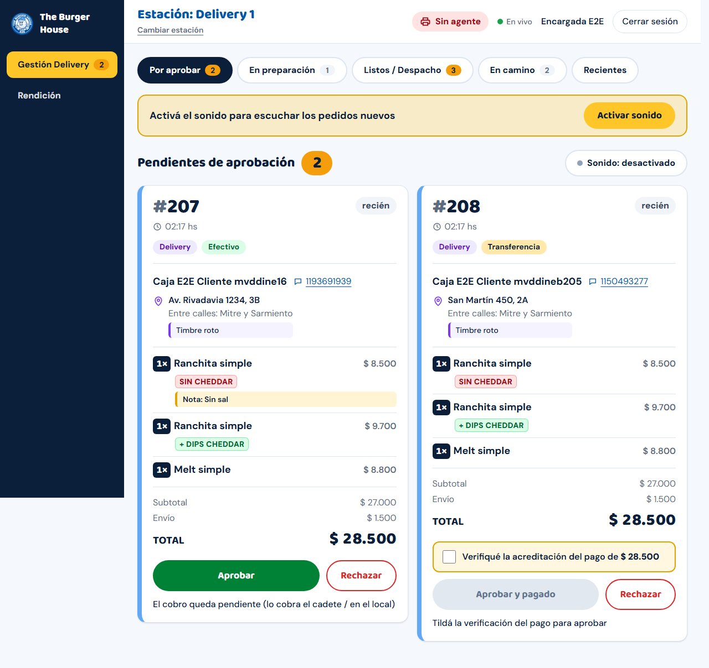
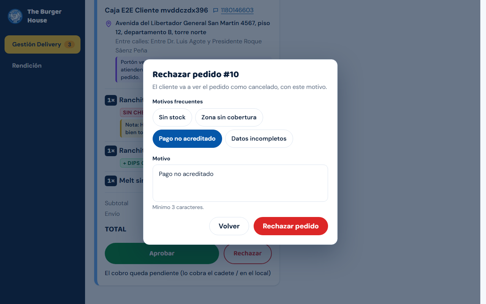
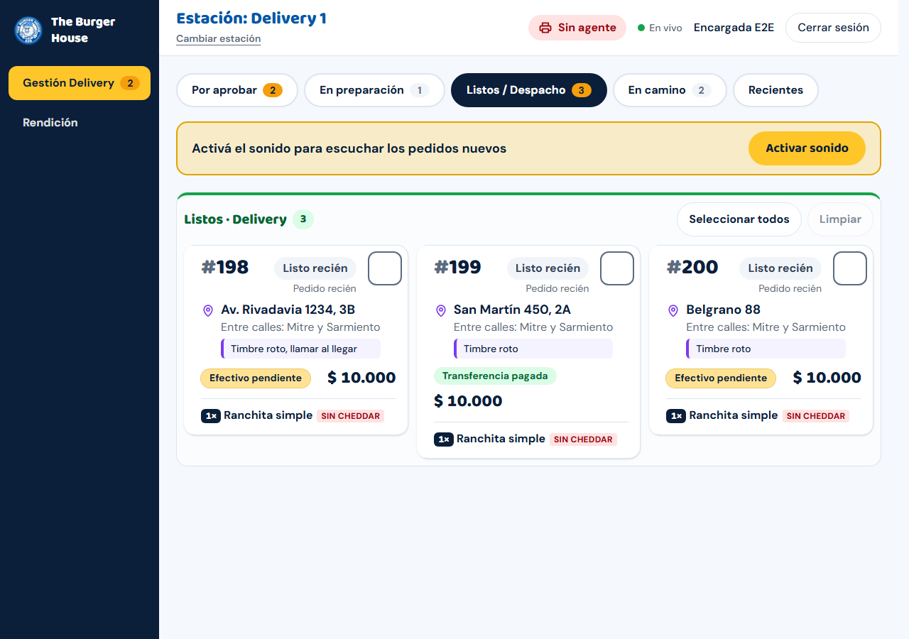
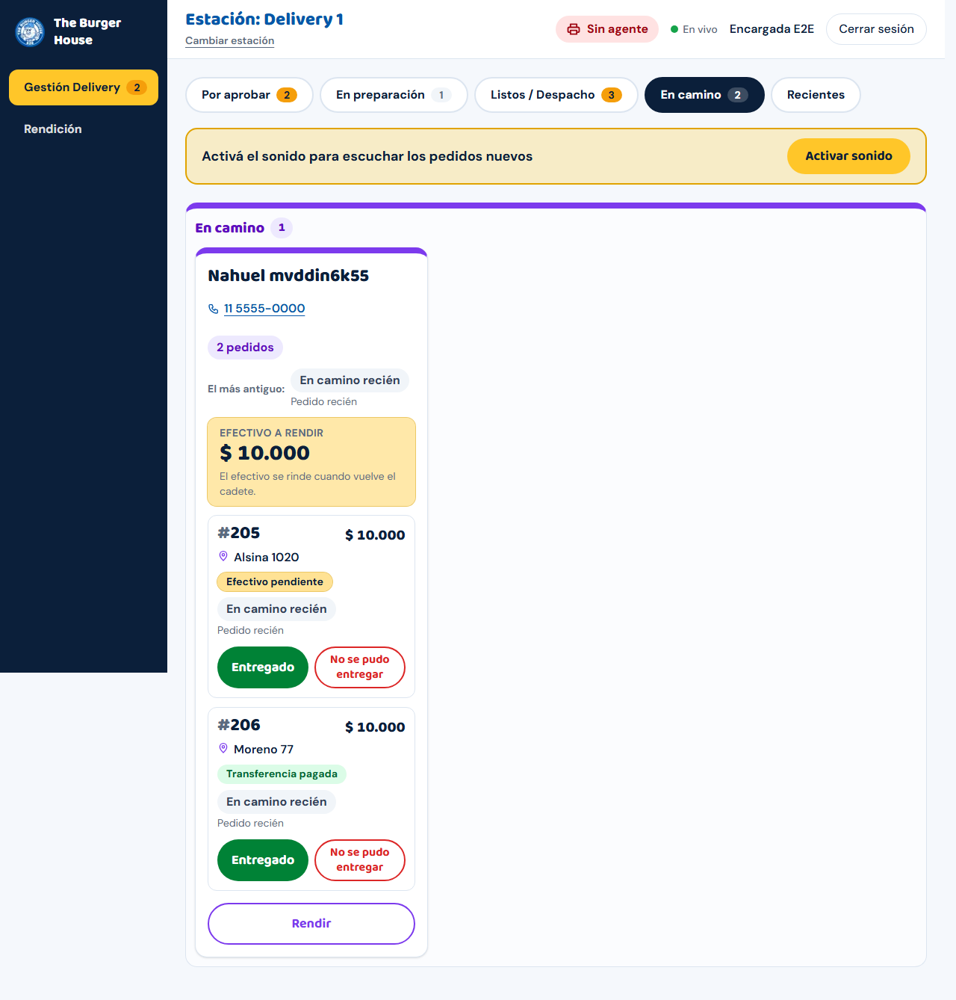
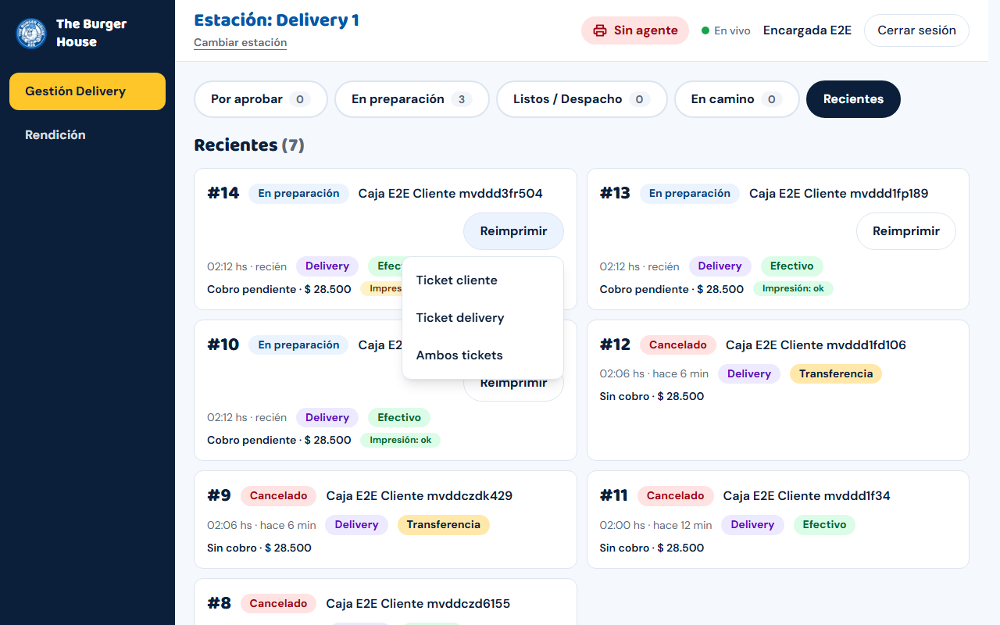
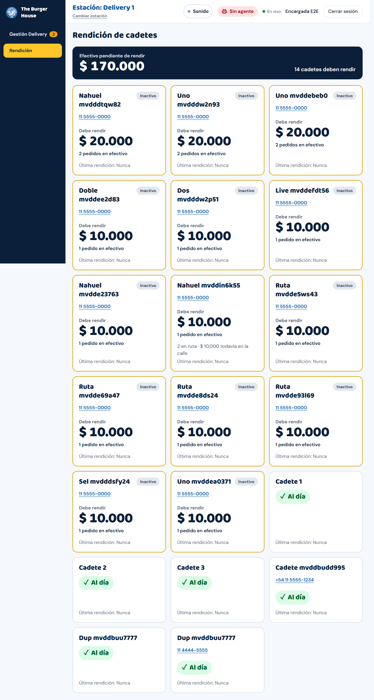
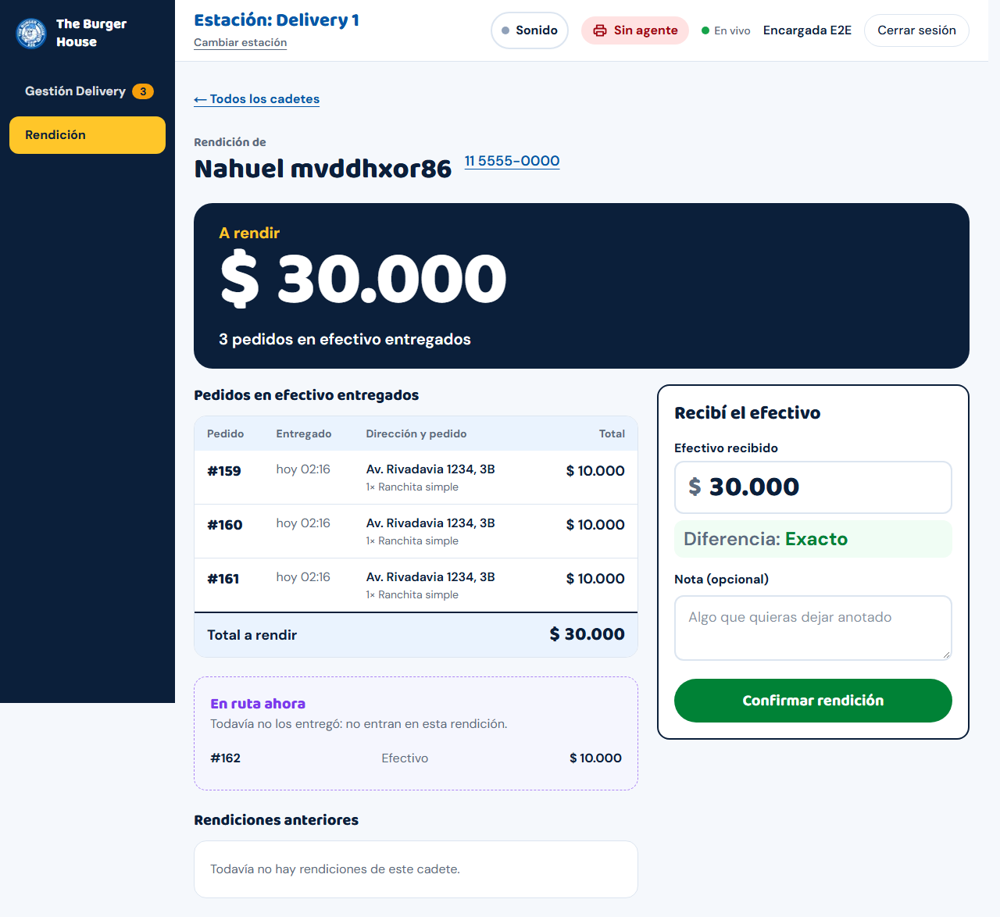
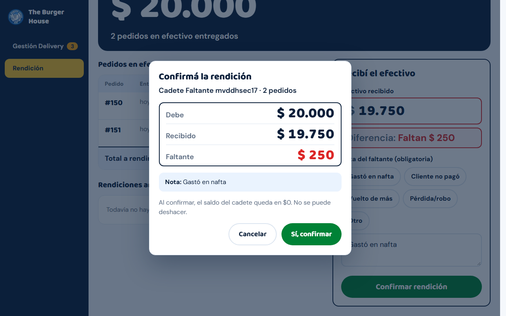

# Guía de una página: Encargada de Delivery

Para quien trabaja en una PC de **Delivery** (Delivery 1 a 5). Las capturas usan datos de prueba.

## Empezar el turno

1. Entrá con tu **usuario y contraseña** y elegí **tu estación Delivery** en **"¿Dónde estás trabajando?"**.
2. Mirá arriba: **"Impresora lista"** (si dice **"Sin agente"** no sale papel), **"En vivo"**, y tocá **Activar sonido** (una vez por turno).
3. Tenés dos pantallas a la izquierda: **Gestión Delivery** y **Rendición**.

En esta PC entran **solo** los pedidos web de **delivery**. Al aprobar, **esta estación imprime dos papeles**: el **ticket de delivery**
(el que viaja con el cadete: número, cliente, teléfono, dirección, productos, cuánto cobrar) y el **ticket del cliente** (con logo
y "GRACIAS POR TU COMPRA"). No sale comanda de cocina: la cocina lee el pedido en **En preparación**.

## 1. Gestión Delivery: cinco pestañas

**Por aprobar · En preparación · Listos / Despacho · En camino · Recientes**. Cada pestaña muestra cuántos pedidos tiene.

### Por aprobar

- **Efectivo**: **Aprobar** (el cadete cobra al entregar).
- **Transferencia**: verificá en el banco que llegó la plata, tildá **"Verifiqué la acreditación del pago de $…"** y apretá **Aprobar y pagado**.
- **Rechazar** (si no hay stock, la zona no tiene cobertura, el pago no llegó o faltan datos):

  

  elegí un motivo o escribilo y **Rechazar pedido**. El cliente ve el pedido cancelado con el motivo.

### En preparación

Cuando la cocina termina, tocá **Listo** en ese pedido. Pasa a **Listos / Despacho**.

### Listos / Despacho: asignar al cadete

1. Tildá los pedidos que lleva **un mismo cadete** (uno o varios; **Seleccionar todos** / **Limpiar**).
2. Abajo aparece la barra de asignación con el resumen (por ejemplo "3 pedidos") y **Efectivo a cobrar**.
3. En **Elegí un cadete…** elegí al cadete y apretá **Asignar a <nombre>**. Los pedidos pasan a **En camino**.

### En camino

Un bloque por cadete, con **Efectivo a rendir**. Por cada pedido:

- **Entregado**: el cadete entregó. (Los pedidos en efectivo quedan con el cobro pendiente hasta la rendición.)
- **No se pudo entregar**: elegí o escribí el motivo → **Volver a despacho**. El pedido vuelve a **Listos / Despacho** y el cadete queda libre de él.
- **Rendir**: va directo a la rendición de ese cadete.

### Recientes

Últimos pedidos, su estado y **Impresión: ok / pendiente / falló**. **Reimprimir** → **Ticket cliente**, **Ticket delivery** o **Ambos tickets**
(se imprime en la estación en la que estás).

## 2. Rendición: cuando el cadete vuelve con la plata

1. Entrá a **Rendición**. Ves la lista de cadetes con lo que debe cada uno (**Al día** si no debe nada).

   

2. Tocá el nombre del cadete. Arriba, **A rendir** es la suma de los pedidos **en efectivo ya entregados** (los que siguen "En ruta ahora" no entran).
3. Contá la plata. En **Recibí el efectivo → Efectivo recibido** viene cargado el total; si el cadete entregó otra cifra, escribila.
   Abajo dice **Diferencia: Exacto** o **Faltan $…** (no se puede recibir más de lo que debe).

   

4. Si **falta plata**, la **Nota del faltante es obligatoria** (podés tocar **Gastó en nafta**, **Cliente no pagó**, **Vuelto de más**, **Pérdida/robo** u **Otro**).
5. Apretá **Confirmar rendición**. Aparece **Confirmá la rendición** con **Debe / Recibido / Faltante**; si está bien, **Sí, confirmar**.

   

   **Ojo:** al confirmar el saldo del cadete queda en **$0** y **no se puede deshacer**; el faltante queda registrado.
6. Sale el comprobante **Rendición #N**. **Imprimir comprobante** lo manda a la impresora de la PC (hoja común, no ticket). **Volver a rendiciones**
   regresa a la lista.

Si dice **"El saldo cambió: antes … ahora …"**, entró otra entrega mientras contabas: revisá la lista y volvé a confirmar. Si dice que
el cadete **ya fue rendido por otra persona**, el saldo ya está en $0.

## Si algo falla

| Qué pasa | Qué hacés |
| --- | --- |
| Cuadro rojo **"N impresiones fallaron"** | Revisá papel, tapa, cable; **Reimprimir**. |
| Falta un ticket | **Recientes** → **Reimprimir** → el que falte. |
| **Sin agente** | Esperá 6 minutos; si sigue, avisá al soporte. Mientras, reimprimí desde otra estación Delivery. |
| **Sin conexión** | Plan de contingencia: `docs/guias/plan-contingencia.md` (pedidos a mano). |
| Un cadete no aparece en la lista | Pedile al administrador que lo cargue o active en **Administración → Cadetes**. |
